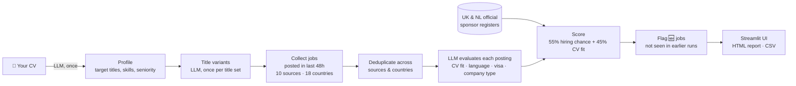

# 🌍 Europe Job Search Agent

**An AI agent that finds fresh jobs every day across Germany, the UK and Europe, and ranks them by how likely the employer is to hire an international candidate who needs a visa and doesn't speak German.**

You upload your CV once. Every morning the agent searches 10 job sources, including the career pages of ~100 visa-friendly tech and AI companies, across up to 18 countries. It flags the jobs you haven't seen before as 🆕. An LLM reads every posting and checks your fit, the language requirements and any visa statements. The agent also checks UK and Dutch employers against the governments' official visa-sponsor registers. The results come out as two ranked lists:

- 🇩🇪 **Germany**
- 🇪🇺 **Rest of Europe & UK**

Each job shows a transparent score breakdown, so you can see *why* it ranked where it did.

---

## Why this exists

Generic job boards rank jobs by keyword relevance. For a non-EU candidate, a perfectly matching job is useless if the ad says *"fluent German required"* or *"we cannot sponsor visas"*. This agent puts **hiring chance** next to **CV fit**:

| Barrier | How the agent handles it |
|---|---|
| Language (the #1 barrier in Germany) | Detects ads written in German and German/local-language requirements, and rewards English-working-language teams |
| Visa sponsorship | Reads "visa sponsorship offered" vs "no sponsorship / must have right to work" |
| UK Skilled Worker visa | Matches the employer against the **Home Office register of licensed sponsors** (~120k employers) |
| Netherlands highly-skilled-migrant visa | Matches against the **IND public register of recognised sponsors** (~13k employers) |
| Germany EU Blue Card | Any employer can sponsor, so the agent checks the stated salary against the 2026 threshold (€45,934 for IT roles / €50,700 standard) |
| Company type | Scale-ups, international tech and startups get a boost; recruitment agencies get a small penalty |

### What the research says

- **Startups in Germany are English-friendly.** In a Bitkom survey of German tech startups, 59% no longer require German and 54% use English as the official company language. Across *all* German job ads, only ~2.7% state that German isn't needed.
- **Scale-ups often beat early-stage startups for visa candidates.** They work in English too, but they also have the HR capacity, relocation budgets and salaries a visa process needs. The ranking reflects this: scale-up +15, international tech +12, startup +10. (This weighting is a judgement call, not a measured result.)
- **In the UK and Netherlands, the sponsor licence is decisive.** An employer that isn't on the register legally can't sponsor the visa, however good the match.

---

## How it works



### Built so you don't miss jobs

- **Overlapping windows.** Each run looks back 48 hours (configurable), so a missed or failed day loses nothing. Jobs already shown in earlier runs aren't marked 🆕, so the overlap doesn't create noise.
- **Daily schedule.** One click in the UI, or `--schedule 08:00`, installs a daily run. On macOS it uses launchd, which runs a missed job as soon as the Mac wakes up.
- **Title variants.** Employers title the same role in many ways. From your titles and CV, an LLM generates ~30 variants (e.g. *LLM Engineer, Applied Scientist, NLP Engineer, KI-Entwickler*). Every job title is matched against all of them, so you can search 5 titles without missing the other 25.
- **Career pages.** Many startups and scale-ups post on their own careers page first, or only there. The agent reads the public job APIs of Greenhouse, Lever, Ashby and SmartRecruiters for every company in `companies.json`.

### Scoring

**Rank = 55% hiring chance + 45% CV fit**

- **CV fit (0–100)** comes from the LLM comparing the posting with your CV.
- **Hiring chance (0–100)** starts at 50 and moves with these signals:

| Signal | Points |
|---|---|
| Visa sponsorship offered | **+25** |
| On UK / NL official sponsor register | **+20** |
| Scale-up / big international tech / startup | +15 / +12 / +10 |
| No local language needed | +12 |
| Relocation support | +12 |
| Ad in English / English working language | +10 / +10 |
| Salary meets Blue Card threshold (Germany) | +5 |
| Consultancy / recruitment agency | −3 / −8 |
| Salary below Blue Card threshold (Germany) | −10 |
| Remote, but only for residents | −20 |
| Ad written in German | −25 |
| UK/NL employer *not* on sponsor register | −25 |
| Local language required | **−35** |
| "No visa sponsorship" | **−50** |

All weights are in `international_score()` in [`job_agent.py`](job_agent.py), so you can tune them easily.

---

## Job sources

| Source | Coverage | Method |
|---|---|---|
| **LinkedIn** + **Indeed** | 18 countries | [python-jobspy](https://github.com/speedyapply/JobSpy), posting-age filter |
| **Glassdoor** | Most of the 18 countries | python-jobspy, filtered by your title variants |
| **Company career pages** | ~100 companies in [`companies.json`](companies.json): AI labs (Anthropic, OpenAI, ElevenLabs, Cohere, DeepL, Helsing, Wayve…), scale-ups (N26, Celonis, Trade Republic, Parloa, Synthesia, Legora…), international tech (Stripe, Databricks, Datadog, Spotify, Monzo, Adyen…) | Greenhouse, Lever, Ashby, SmartRecruiters public APIs |
| **Arbeitnow** | Germany (English-speaking, visa-friendly) | Public API |
| **Berlin Startup Jobs** | Berlin startups | RSS feed |
| **Make it in Germany / Bundesagentur für Arbeit** | All of Germany (the official federal job board) | Public job-search API |
| **EURES** | EU/EEA + Switzerland (EU's official job portal) | Portal search API |
| **XING** | Germany, Austria, Switzerland | Search page data |
| **NextJobFinder** | All searched countries | Search pages |
| **Adzuna** *(optional)* | 10 countries | Official API (free key) |

**Add your own target companies** to `companies.json`. Find the slug in their careers URL, e.g. `boards.greenhouse.io/<slug>`, `jobs.lever.co/<slug>`, `jobs.ashbyhq.com/<slug>` or `jobs.smartrecruiters.com/<slug>`:

```json
{"name": "Example AI", "ats": "ashby", "slug": "exampleai"}
```

*StepStone (Germany's largest job board) isn't included because it blocks automated access.*

Countries: 🇩🇪 Germany, 🇬🇧 UK, 🇳🇱 Netherlands, 🇮🇪 Ireland, 🇨🇭 Switzerland, 🇦🇹 Austria, 🇫🇷 France, 🇪🇸 Spain, 🇵🇹 Portugal, 🇵🇱 Poland, 🇸🇪 Sweden, 🇩🇰 Denmark, 🇫🇮 Finland, 🇳🇴 Norway, 🇧🇪 Belgium, 🇨🇿 Czech Republic, 🇱🇺 Luxembourg, 🇮🇹 Italy.

---

## Quick start

### 1. Install

Requires Python 3.11+.

```bash
git clone https://github.com/JYOTSNACHOUDHARY/ai-job-search-agent.git
cd ai-job-search-agent

python -m venv .venv && source .venv/bin/activate
pip install -r requirements.txt
```

### 2. Add your OpenAI key

```bash
cp .env.example .env
# then edit .env and set OPENAI_API_KEY
```

### 3. Launch the UI

```bash
streamlit run app.py
```

Then:

1. **Upload your CV** in the sidebar and click **Analyse CV**. This runs only once.
2. **Check the job titles** it suggests and edit them if needed. 3–5 is best; the AI adds variants automatically.
3. Pick your **countries**, **sources** and **window**, and click **Save as default settings**.
4. Click **🔎 Find jobs** for a first run, then **Schedule** a daily run in section 3 of the sidebar.
5. Each morning, open the UI, switch on **🆕 Only new jobs**, and click **Open ↗** to apply.

### UI features

- Live progress log while the agent searches
- Hiring chance and CV fit shown as progress bars, plus a full score breakdown per job
- A **Posted** column ("4h ago", "Yesterday") so you always know how fresh a job is
- 🆕 markers and an "Only new jobs" filter
- Daily-schedule controls and the last scheduled run's log
- Filters for minimum CV fit, minimum hiring chance, company type and keyword
- One-click toggles to hide "no visa sponsorship", "local language required" and recruitment agencies
- Browse previous days' runs
- CSV download per tab

---

## Command line & daily automation

Everything in the UI also works from the terminal:

```bash
# first run: read the CV
python job_agent.py --cv ~/Documents/cv.pdf

# daily run (reuses the saved profile)
python job_agent.py

# faster: fewer countries / chosen sources / a 24h window
python job_agent.py --countries "United Kingdom" Netherlands Ireland --sources linkedin-indeed careers --hours 24

# daily automatic run at 08:00 (uses the saved settings), and removing it
python job_agent.py --schedule 08:00
python job_agent.py --unschedule

# all options
python job_agent.py --help
```

Each run writes its own folder, `output/<date>_<time>/`, containing:

- `results.json`: all evaluated jobs (the UI reads this)
- `jobs.html`: a standalone report with two tabs
- `germany.csv` and `rest_of_europe_uk.csv`

Without flags, the command line uses the settings saved from the UI (`settings.json`), so the scheduled run searches exactly what you chose. On Linux, `--schedule` prints a crontab line to add instead. Scheduled runs log to `data/daily_run.log`.

---

## Configuration

| Setting | Where | Default |
|---|---|---|
| `OPENAI_API_KEY` | `.env` | *required* |
| `ADZUNA_APP_ID`, `ADZUNA_APP_KEY` | `.env` | off |
| `JOB_AGENT_MODEL` | `.env` | `gpt-4.1-mini` |
| `JOB_AGENT_MIN_FIT` (hide jobs below this CV fit in the HTML/CSV reports) | `.env` | `45` |
| Job titles to search | UI sidebar, or `search_terms` in `profile.json` | generated from your CV |
| Countries, sources, window, results per search | UI sidebar → `settings.json`, or CLI flags | UK, NL, IE, CH, AT + Germany · all sources · 48h · 25 |
| Title variants | generated automatically into `profile.json` (`title_variants`) | ~30 |
| Companies whose career pages are checked | `companies.json` | ~100 |
| Daily schedule | UI sidebar or `--schedule HH:MM` | off |

**Cost & time:** a run with 5 job titles × 6 countries and all sources takes roughly 20–60 minutes, depending mostly on LinkedIn, and typically costs well under $1 of OpenAI usage. LLM evaluations are cached, so re-running the same day is almost free. Select fewer countries for faster runs.

---

## Project structure

```
job_search_agent/
├── app.py            # Streamlit UI
├── job_agent.py      # the agent: CV → collect → evaluate → rank → report (also the CLI)
├── companies.json    # career pages to check - add your target companies
├── requirements.txt
├── .env.example
├── profile.json      # your parsed CV, titles + variants    (git-ignored, created on first run)
├── settings.json     # saved search settings                (git-ignored)
├── data/             # sponsor registers, LLM cache, seen jobs, CV, run log (git-ignored)
└── output/<date>_<time>/  # results.json, jobs.html, CSVs   (git-ignored)
```

---

## Privacy

- Your CV, profile and results stay on your machine. They are git-ignored, so they won't be pushed to your repo.
- CV text and job postings are sent to the OpenAI API for analysis.

## Limitations & responsible use

- **Unofficial sources can break.** LinkedIn, Indeed, XING, NextJobFinder, EURES and the Bundesagentur endpoints aren't official public APIs. A site redesign can break a source without warning. The agent skips failing sources and keeps going.
- **Rate limits.** LinkedIn throttles heavy scraping, so keep runs to a modest daily volume for personal use and respect each site's terms.
- **Coverage isn't complete.** StepStone and companies' own websites outside the four supported job platforms aren't covered, and LinkedIn/Indeed/Glassdoor return a capped number of results per search. Use the agent as your daily shortlist alongside networking and referrals.
- **"Posted" isn't always the original posting date.** XING reports when a job was last *refreshed*, and some sources only give a date.
- **The LLM can be wrong.** Company type (startup vs scale-up) and fit scores are judged from the ad text, so treat the scores as a triage aid, not a verdict.
- **Visa rules change.** The Blue Card thresholds are for 2026. Always verify visa details with the employer and the official immigration authority.
